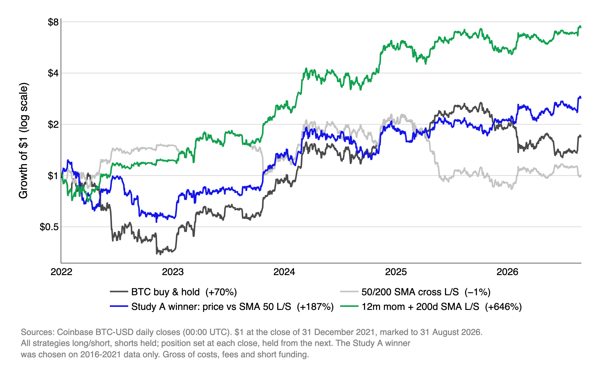

# Crypto Backtesting Framework

A research framework for testing systematic crypto trading strategies, built in Python. It is designed
to answer one question honestly: **would this strategy really have made money, trading only on
information available at the time?**

Every result here is pre-registered (rules written down before the run), free of lookahead (proven by test,
not assumed), executable at realistic institutional timing, and independently re-derived from raw prices on
every run. One command rebuilds every backtest, runs every audit, and redraws every chart.



## Headline results: BTC, 31 Dec 2021 to 31 Aug 2026

| Strategy | Total return | Sharpe | Max drawdown | Verdict |
|---|---|---|---|---|
| BTC buy & hold (benchmark) | +70% | 0.48 | −67% | — |
| 50/200-day SMA cross, long/short | −0.8% | 0.21 | −64% | Loses to buy & hold (whipsawed) |
| **12-month momentum + 200-day SMA, long/short** ("Simplicity in Trading BTC") | **+646%** | **1.22** | **−32%** | Beats buy & hold; robust, but rests on two short calls (p = 0.066) |
| Close vs 50-day SMA, long/short (data-mined winner of 13 features) | +187% | 0.72 | −57% | Not significant after multiple-testing correction (p = 0.054) |

Coinbase BTC-USD daily bars, gross of costs. Position set at each close, traded from the next bar.
The rules keep running live on new data after the 31 Aug 2026 cutoff (`charts/btc_live_update/final/`).

**What the research found:** a simple slow-trend rule (stay long unless both 12-month momentum and price vs its
200-day average turn negative) beat buy & hold on return, Sharpe and drawdown, and the result holds across 22 of 25
nearby parameter settings and all 25 start dates tested. But the edge comes from two well-timed short periods
(2022 and 2026), so it is credible, not proven. A separate study of 13 common trend indicators found that the "most
predictive" one changes between periods (rank correlation −0.58 out of sample). Choosing indicators by past ranking
is mostly noise.

## What makes it rigorous

- **Pre-registration.** Each strategy's rules, window, and success criteria are written into this README before
  the backtest is run. Anything changed after seeing a result is disclosed as an amendment.
- **No lookahead, proven.** `signals.assert_causal()` fails any signal whose past values change when future data is
  removed. Each audit also scrambles all prices after each of 40 cut dates and checks that earlier results stay bit-identical.
- **Executable timing.** Signals are computed on day *t*'s close and filled at day *t+1*'s open. The engine refuses a
  zero-day lag. Each strategy is also stress-tested with an extra day of delay.
- **No black boxes.** `verify_processed.py` recomputes every backtest from raw prices in plain Python, without using
  the framework's own code, and checks it matches to ~1e-14.
- **Overfitting checks.** Parameter-neighbourhood and start-date sweeps, a random-timing null (the same trades on the
  wrong dates), and a best-of-N shuffled null for anything chosen from a set of candidates.
- **Verified data.** Daily bars are rebuilt from hourly candles, the cache is re-checked against a fresh Coinbase pull,
  and prices are cross-checked against Bitstamp (within 0.42% every day since 2020).
- **Full trade ledgers** for every strategy in `data/processed/*_trades.csv`, plus a run log in `data/findings_log.csv`.

## Repository layout

| Path | Contents |
|---|---|
| `src/` | Reusable library: market data (CCXT / yfinance with local cache), signals, backtest engine, metrics, predictability statistics |
| `scripts/build_*.py` | Reproduce each backtest from cached prices into `data/processed/` |
| `scripts/verify_*.py` | Audits: hand re-derivation, future-scramble lookahead test, lag stress, next-open fills, data checks |
| `scripts/robustness_*.py` | Overfitting checks: parameter grid, start dates, random-timing null |
| `scripts/chart_*.py` | Render the final exhibits in `charts/*/final/` |
| `scripts/run_all.py` | One command: tests → builds → audits → charts. Stops at the first failure |
| `notebooks/research_book.ipynb` | Exploration notebook, one section per study |
| `tests/` | 35 offline unit tests (engine, signals, causality, metrics) |
| `data/` | Cached raw prices, processed backtests, trade ledgers, findings log |

## Quick start

```bash
git clone https://github.com/kailenvyas121/crypto-backtesting-framework.git
cd crypto-backtesting-framework
python3 -m venv .venv && source .venv/bin/activate
pip install -r requirements.txt

python scripts/run_all.py            # rebuild, audit, and chart everything from cached prices
python scripts/run_all.py --online   # also pull the latest prices and audit them against Coinbase + Bitstamp
```

Stack: Python, pandas, NumPy, SciPy, CCXT, yfinance, Plotly, pytest.

---

# Research log

The detailed record of every study, in the order run: the pre-registered spec, then the result, amendments, and
audit findings. Notebooks are where ideas are explored, `src/` holds reusable computation, and `scripts/`
reproduces final results. The full workflow is in [WORKFLOW.md](WORKFLOW.md); data provenance is in
[data_map.md](data_map.md); every run is in `data/findings_log.csv`.

## Current spec -- BTC buy & hold, Jan 2022 to Aug 2026 (pre-registered 2026-09-29)

- **Question:** what did an unlevered, never-rebalanced BTC position return over the window?
  It is the benchmark every later signal is measured against.
- **Universe:** Coinbase BTC-USD spot, daily bars 00:00-24:00 UTC.
- **Window:** $1 in at the close of 31 Dec 2021, marked at the close of 31 Aug 2026.
- **Conventions:** simple close-to-close returns, 1-bar lag, gross of costs, 365 periods/year.
- **Sanity check / null:** total return must equal `last_close / entry_close - 1` exactly;
  zero missing days in the window.

**Result:** +70% total, 12% CAGR, 51% vol, Sharpe 0.48, Sortino 0.70, max drawdown -67%
(trough 21 Nov 2022), Calmar 0.18. Entry close $46,211.24, final close $78,562.74.
Exhibits: `charts/btc_buy_hold/final/`.

## Spec 2 -- BTC 50/200-day SMA trend, long/short (pre-registered 2026-10-03)

- **Question:** does a 50/200-day moving-average trend rule, long or short BTC, beat buy & hold
  on the same window, on a risk-adjusted basis (Sharpe, max drawdown, Calmar)?
- **Rule:** after each daily close, compute the simple 50-day and 200-day moving averages of close.
  50 > 200: hold +1 BTC (long). 50 < 200: hold -1 BTC (short). Always fully invested, unlevered,
  never flat (an exact tie holds 0). The position decided at day *t*'s close earns day *t+1*'s
  return, the same 1-bar lag as the benchmark.
- **Universe, window, conventions:** identical to spec 1, so the two are directly comparable:
  Coinbase BTC-USD daily, $1 in at the close of 31 Dec 2021, marked at the close of 31 Aug 2026,
  simple returns, 365 periods/year. The averages are warmed up on cached history before 2022, so the
  strategy holds a position from the first day.
- **Parameters fixed in advance:** 50 and 200, the textbook golden/death cross. No other lengths
  are tried in this spec, so the result is not the best of a search.
- **Costs:** headline numbers gross, like spec 1. Sensitivity reported at 10 bps per unit of
  turnover (a long-to-short flip is 2 units). The short leg's borrow and perp funding are not
  modelled; they would reduce the short side's returns.
- **Amendment (2026-10-03, after the first run):** the first run used the engine's default
  daily-rebalanced -1 weight, an inverse-ETF short, which decays in volatile markets: BTC fell 46% in
  the 2022 short leg but that short made only +21%. The spec's intent, "hold -1 BTC", is a held short:
  sell at the cross, hold the units to the next cross. The headline now uses that
  (`backtest.run(sizing="units")`). The daily-rebalanced result is still reported alongside it,
  because this change was made after the result was seen.
- **Null:** the strategy's Sharpe is no better than buy & hold's 0.48 and its max drawdown is no
  smaller than -67%. With roughly 4.7 years and only a handful of crosses, a win is weak evidence on
  its own: few independent trades.

**Result: the null stands.** The strategy returned -0.8% vs +70% for buy & hold, with Sharpe 0.21 vs 0.48,
Sortino 0.31, max drawdown -64% vs -67% (trough 14 Jan 2026), vol 43% and Calmar -0.00. It made 9 crosses
(1.9 a year), 50% long and 50% short. The 2022 short made +46%, but three short whipsaws (Sep-Oct 2023 -33%,
Aug-Oct 2024 -15%, Apr-May 2025 -41%) and the 2025 long (-16%) gave it all back. Sensitivities: 10 bps costs
-3%; daily-rebalanced short -9% (Sharpe 0.22). Exhibits: `charts/btc_sma_cross_50_200/final/`.
Audit (`scripts/verify_btc_sma_cross.py`): a hand re-derivation matches to 3e-15. Scrambling all prices
after 40 cut dates leaves every earlier value bit-identical. Every trade is in
`data/processed/btc_sma_cross_50_200_trades.csv`. Trading one bar later (lag 2) gives -19%, Sharpe 0.12: the
result is sensitive to execution delay. Filling at the actual next-day open (the institutional convention)
gives -0.77% vs -0.76%, because Coinbase's 00:00 open equals the prior close within 0.03%. The lag-1 numbers are
therefore executable, not optimistic.

## Study A -- which trend features predict BTC's next-day return (pre-registered 2026-10-07)

- **Question:** of a fixed set of common trend features, which (if any) carry information about BTC's
  next-day return, and does a discovery-period ranking survive out of sample?
- **Features (13, fixed in advance, each +1 / -1 decided at day *t*'s close, using bars <= *t*):**
  sign of the trailing 30, 90, 180 and 365-day return (`mom_30` ... `mom_365`); close above/below
  SMA 20, 50, 100, 200 (`px_sma_20` ...); SMA crosses 20/50, 50/100, 50/200, 100/200 (`cross_20_50` ...);
  and the spec 3 rule (`mom365_sma200`). An exact tie counts as -1 for momentum/price features, 0 for crosses
  (never happens on real data at 1e-8 precision; reported if it does).
- **Target:** the next-day simple return r[*t+1*], the return a lag-1 trade on the feature would earn.
  Secondary: the next-7-day return (overlapping; reported, not ranked on).
- **Statistic:** spread = mean(r[*t+1*] | feature = +1) - mean(r[*t+1*] | feature = -1), with a Newey-West
  t-stat (10 lags for 1-day, 7+ lags for 7-day). Also: hit rate and Sharpe of the +1/-1 timing return.
- **Discovery / holdout:** features are ranked by discovery t-stat on 20 Jul 2016 (first bar with 365-day
  history) to 31 Dec 2021. The holdout, 1 Jan 2022 to 31 Aug 2026 (same window as specs 1-3), is reported for
  the SAME ranking, never re-ranked.
- **Multiple testing:** the best of 13 looks good by chance. Null distribution of the max t-stat: circularly
  shift the return series against the features (1,000 random offsets, at least 365 days), recompute all 13
  t-stats, keep the max. The winner's discovery t-stat is reported against that distribution.
- **Overlay:** the discovery winner is then traded as a +1/-1 held position (`sizing="units"`) on the holdout
  window next to buy & hold, the 50/200 cross and spec 3. No other choice is made after seeing holdout data.
- **Null:** no feature's discovery t-stat beats the 95th percentile of the shuffled max; or the winner's
  holdout spread has the wrong sign or a t-stat below 1. ~4.7 holdout years is short: daily BTC returns are
  noisy enough that even a real effect may not reach t = 2 there.

**Result: inconclusive at best -- treat the null as standing.** (Corrected 2026-10-09: the first write-up said "technically rejected" on the 1,000-shuffle cut-off of 2.66. The audit reran the same pre-registered null with another seed (cut-off 2.69), then with 10,000 shuffles: 95th pct 2.69, winner p = 0.054 +/- 0.002. So the winner does not clear the best-of-13 bar.) All 13 features had a
positive next-day spread in discovery, and 11 of 13 are positive in holdout, so trend carries some information in BTC.
The discovery winner, close > SMA 50 (spread +50 bp/day, t = 2.67), only just clears the best-of-13 null (95th pct 2.66,
p = 0.049). Its holdout spread is +15 bp, t = 1.21. The rank correlation of discovery vs holdout t-stats is -0.58: the
fast features (SMA 20/50, 30-day) led in 2016-2021, and the slow ones led in 2022-2026 (spec 3 rule t = 2.12, close vs
SMA 200 t = 1.72, 365-day t = 1.39). The overlay trades the winner long/short with held shorts on 2022-2026: +187%,
Sharpe 0.72, max drawdown -57% (vs buy & hold +70%, 0.48, -67%). Lesson: "which MA is most predictive" is not a stable
answer here, so pick by a pre-set rule, not by ranking. Exhibits: `charts/btc_trend_predictability/final/`. Full table,
including the 7-day horizon: `data/processed/btc_trend_predictability.csv`.
Audit (`scripts/verify_btc_trend_predictability.py`): the split matches the stated windows bar for bar. Scrambling every 2022+ price leaves the discovery table and ranking bit-identical. A plain-Python re-derivation of all 26 rows matches to 4e-15. A peeking feature scores t = 25.5 and 200 coin-flip features give sd(t) = 1.02, so the t-stat is calibrated. Features one day staler (lag 2): winner t 2.67 -> 2.25, rank correlation +0.86.

## Spec 3 -- BTC 12-month momentum + 200-day SMA, long/short (pre-registered 2026-10-07)

- **Source:** my own earlier model, published as "Simplicity in Trading BTC" ("long unless 12m momentum & 200d MA both go negative, then short";
  posted result +4,258% vs +774% buy & hold over 6 years, window not recorded, so not reproduced here).
- **Rule:** after each daily close, `mom` = close / close 365 days earlier - 1 and `sma` = 200-day simple
  average of close. Short (-1 BTC) when `mom < 0` AND `close < sma`; otherwise long (+1 BTC). Always in
  the market, unlevered. Shorts held (`sizing="units"`). Decided at *t*'s close, earns *t+1*'s return.
- **Definitions fixed where the post was ambiguous (2026-10-07, before any run):** "200d MA
  negative" = close below the MA (not MA slope); "12m" = 365 calendar days (BTC trades daily);
  exit from short goes straight back to long.
- **Window, conventions, costs:** identical to spec 2 (Coinbase BTC-USD daily, 31 Dec 2021 close to
  31 Aug 2026 close, warm-up on cached history, gross; 10 bps/turnover sensitivity; daily-rebalanced short
  as a sensitivity). Secondary, reported but not judged on: the full cached history from 20 Jul 2016.
- **Not a clean out-of-sample test:** the rule was posted after it had already worked on some past window,
  likely overlapping this one, and is tested now after spec 2 failed. Treat a win as confirmation of a
  known result, not a discovery.
- **Null:** Sharpe no better than buy & hold's 0.48 and max drawdown no smaller than -67%.

**Result: the null is rejected.** +646% vs +70% for buy & hold, CAGR 54%, Sharpe 1.22 vs 0.48, Sortino 1.88, max
drawdown -32% vs -67% (trough 29 Mar 2022), vol 43%, Calmar 1.67. It made 8 changes in the window (1.7 a year) and was
short 36% of days. The edge comes from two short legs and from staying long through the 2023-2025 dips that whipsawed the
50/200 cross. Short 9 Feb 2022 at $44,086, covered 14 Jan 2023 at $19,935. Short again 20 Nov 2025 to 20 Aug 2026,
apart from 2 days long in Jan 2026. Few independent bets, so this is weaker evidence than the numbers suggest.
Sensitivities: 10 bps costs +633%; daily-rebalanced short +581% (Sharpe 1.06). The secondary full history, Jul 2016 to
Aug 2026 (not judged on), gives +78,024% vs +11,557%, Sharpe 1.36 vs 1.04, max drawdown -70% vs -84%. Exhibits:
`charts/btc_mom_sma/final/`. Audit (`scripts/verify_btc_mom_sma.py`): a hand re-derivation matches to 3e-14. The
future scramble is bit-identical at 40 cuts. The ledger is `data/processed/btc_mom_sma_trades.csv`. Lag 2 gives +583%,
Sharpe 1.17 (robust to execution delay, unlike spec 2). Next-open fills give +645.6% vs +645.8%.

**Overfitting checks (`scripts/robustness_btc_trend.py`, run 2026-10-09 after the result, reported only):**
- *Parameters:* 22 of 25 neighbouring settings (365-day lookback 180-545 x SMA 100-300) beat buy & hold's Sharpe, and the
  surface is smooth: median 0.90, and 365/200 ranks 4th (270/200 is higher, 1.33). Not an isolated peak.
- *Start date:* it beats buy & hold's Sharpe for all 25 month-end starts, Dec 2021 to Dec 2023.
- *Where the edge comes from:* long runs earn exactly buy & hold's return. The whole edge is two short runs: Feb 2022 to
  Jan 2023 (+55% while BTC -55%) and Jan to Aug 2026 (+28% while BTC -28%). With the long 2023-25 run in cash it would
  be +63%. Effectively **two decisive bets**.
- *Random-timing null:* the same position path shifted to the wrong dates (2,000 shifts) gives a median Sharpe of 0.17;
  the real 1.22 sits at p = 0.066. Good, but **not significant at 5%** on this window. 713 of 2,000 shifted paths are
  wiped out (a held 1x short through a >2x rally).
- *Before 2022 (not out of sample):* 2016-2018 Sharpe 1.70 vs 1.25 for buy & hold. 2019-2021: 1.20 vs 1.50, +534% vs
  +1,152%, i.e. it **lagged** buy & hold through a bull market with sharp dips.
- *Study A winner (close vs SMA 50):* random-timing p = 0.051. Its neighbours are noisy (SMA 30: 0.34, 40: 0.84,
  60: 0.64, 200: 0.92). Not a robust choice.

**Verdict:** the rule is robust to parameter and start-date choices and has no lookahead. But the evidence on 2022-2026
rests on two bear-market calls, and that is not statistically separable from luck at 5%. It is a credible trend rule,
not a proven edge.

## Tracking update (rules unchanged, data after the pre-registered window)

`scripts/build_btc_live_update.py` extends every rule unchanged to the latest closed bar; chart:
`charts/btc_live_update/final/`. As of the 8 Oct 2026 close ($81,693; BTC +4.0% since 31 Aug): buy & hold +76.8%,
50/200 +3.5%, spec 3 +675.5%, Study A winner +198.6% (all since 31 Dec 2021). All four are long now. Only 38 days
out of sample, far too short to judge anything.

## Integrity checks that run on every `run_all.py`

- `verify_processed.py`: every processed backtest is re-derived from the raw cache in plain Python, checking calendar,
  closes, signal, the 1-bar lag, equity, and metrics vs `src/metrics.py` and the findings log.
- `verify_btc_sma_cross.py`, `verify_btc_mom_sma.py`, `verify_btc_trend_predictability.py`: lookahead and leakage
  audits per study.
- `robustness_btc_trend.py`: the overfitting checks above.
- With `--online`, `verify_btc_data.py` audits the full history 2015 to the latest bar. Since 2020: Bitstamp agrees within
  0.42% every day. Before 2020: 14 days in 2016-17 differ by over 3% (e.g. the Dec 2017 Coinbase premium), each proven
  a genuine Coinbase print from its hourly candles. (Check split by era on 2026-10-09, after the full-history run flagged
  those days.)

## Market data

Prices come from one place: `src/market_data.py`.

```python
from src.market_data import MarketData
data = MarketData()                                   # default crypto venue: Coinbase

btc = data.get("BTC", start="2018-01-01")             # -> Coinbase BTC/USD, 1d
eth = data.get("ETH/USD", start="2024-01-01", timeframe="1h")
spy = data.get("SPY", start="2010-01-01")             # -> yfinance, 1d, close AND adj_close
btc = data.load("BTC")                                # cache only, never the network
data.update("BTC"); data.update_all(); data.validate("BTC"); data.info("BTC")
```

Daily refresh: `python scripts/update_market_data.py` (or `--asset BTC`). It prints rows
added and validation status, and regenerates the market-data section of `data_map.md`.

**Why not tvdatafeed.** It scraped TradingView's websocket, an unofficial and fragile route
to ticker history. The stack here uses documented public endpoints and keeps a local cache,
so nothing is redownloaded and the source of every price is explicit.

- **Equities / ETFs / indexes:** yfinance, `auto_adjust=False`, raw `close` and `adj_close`
  both kept, dividends and splits as columns. Sessions checked against the NYSE (`XNYS`) calendar.
- **Crypto:** CCXT, public endpoints, rate limiting on. Shorthand (`BTC`) resolves to USD,
  then USDC -- never USDT unless asked for explicitly (`BTC/USDT`). Exchanges are never spliced.
- **Storage:** Parquet under `data/raw/market/`, with a `.meta.json` sidecar per dataset.

**Flow:** provider -> `data/raw/market` (validated, closed bars only) -> `scripts/build_*.py`
-> `data/processed/` -> backtest -> `scripts/chart_*.py` -> `charts/`. Only
`update_market_data.py` (or `get()` in a notebook) touches the network; builders and chart
scripts read from disk, so a new bar never silently changes a final chart.

**Integrity rules, enforced in code:** timestamps sorted, unique, UTC; no forward or back
filling; gaps reported, never invented; the currently forming bar is excluded unless
`include_incomplete=True`; `update()` refetches the last 3 bars and logs any value the provider
revised; `backtest.run()` rejects lag < 1; `signals.assert_causal()` fails any signal whose
past output changes when future data is removed.

**Limitations.** yfinance is an unofficial Yahoo wrapper and free data can have missing or
delayed sessions. Yahoo intraday history is short (about 60 days below 1h, 730 days at 1h).
CCXT history depth depends on each exchange. Free OHLCV is not execution-grade: no bid/ask,
order book, funding or open interest, and none is faked from bars. A fixed list of today's
tickers carries survivorship bias; nothing here corrects for it.

## How to run it

One command rebuilds everything, audits it, and redraws every chart. It stops loudly if any check fails.

```bash
~/.venvs/research/bin/python scripts/run_all.py            # uses cached prices
~/.venvs/research/bin/python scripts/run_all.py --online   # also refreshes prices + audits them vs Coinbase and Bitstamp
```

To explore or try a new idea, open the notebook (kernel "Python (research)"):

```bash
~/.venvs/research/bin/jupyter lab notebooks/research_book.ipynb
```

## Backtest rules (every strategy, no exceptions)

1. **Daily bars run 00:00 to 24:00 UTC** (Coinbase). Verified by rebuilding days from hourly candles.
2. **Decide on today's close, trade from the next bar.** Nothing the strategy does can use a price it
   could not have seen yet. The engine refuses a 0-day lag.
3. **Fixed rules, written down first.** Parameters go in this README before the run; no searching for
   the best ones. Anything changed after seeing a result is disclosed here.
4. **Gross of costs.** No transaction, slippage or funding costs.
5. **Proven, not assumed.** `scripts/verify_*.py` recomputes the result by hand, scrambles the future to
   prove no lookahead, lists every trade, and cross-checks prices against a second exchange.
